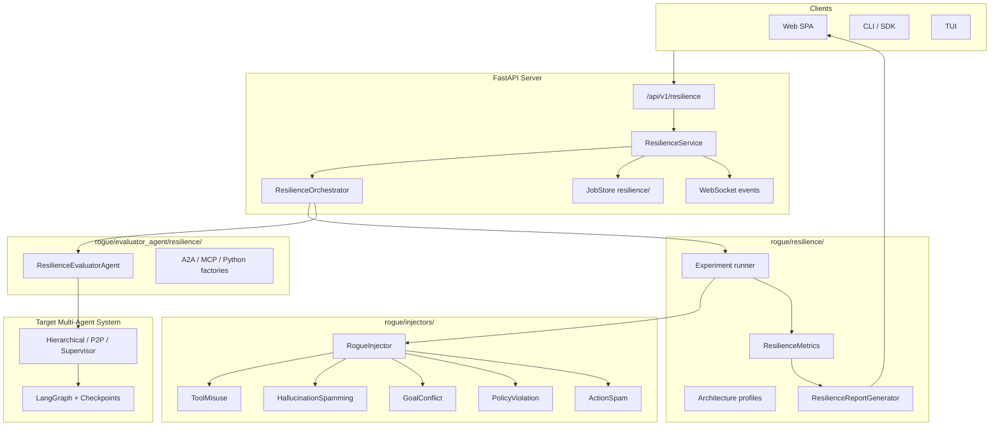
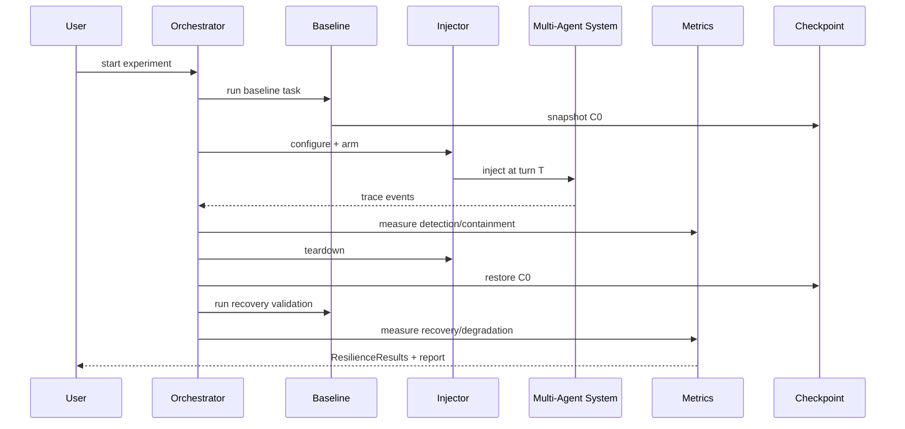

# Rogue Resilience — Full Extension Plan

This plan extends [Qualifire Rogue](https://github.com/qualifire-dev/rogue) with a third evaluation pillar focused on **multi-agent fault tolerance**: injecting rogue/malicious behavior, measuring detection/containment/recovery, and visualizing chaos experiments. It is designed to plug into Rogue's existing client–server architecture without breaking Policy or Red Team flows.

---

## 1. Positioning vs. Existing Rogue

Rogue today has two tracks:

| Track | Purpose | Key path |
|-------|---------|----------|
| **Policy** | Business-rule compliance via judge LLM | `evaluator_agent/` → `EvaluationOrchestrator` |
| **Red Team** | Adversarial security (prompt injection, PII, etc.) | `server/red_teaming/` → `RedTeamOrchestrator` |

**Rogue Resilience** is a distinct third track:

| Track | Purpose | Analogy |
|-------|---------|---------|
| **Resilience** | System behavior when an agent goes rogue inside a multi-agent system | Chaos engineering for agent orchestration |

**Boundary with Red Team `Robustness`:** Existing `Robustness` tests whether a *single* agent can be hijacked by an external attacker. Resilience tests whether a *system* detects, contains, and recovers when an internal agent misbehaves — including cascading failure across peers/supervisors.

---

## 2. High-Level Architecture



**Design principle:** Resilience follows the same layering as Red Team — catalog → orchestrator → service → API → UI — but the inner loop is **inject → observe system → measure lifecycle metrics**, not **attack → judge single response**.

---

## 3. Module Structure

Proposed layout (aligned with requested paths, mapped to Rogue conventions):

```
rogue/
├── resilience/                          # Core domain module
│   ├── __init__.py
│   ├── models.py                        # Pydantic: ResilienceConfig, ExperimentResult, etc.
│   ├── catalog/
│   │   ├── injectors.py                 # InjectorId registry (like vulnerabilities.py)
│   │   ├── architectures.py             # Hierarchical, peer-to-peer, supervisor-worker
│   │   └── scenarios.py                 # Pre-built chaos experiment templates
│   ├── orchestrator.py                  # ResilienceOrchestrator (engine)
│   ├── experiment_runner.py             # Single experiment lifecycle
│   ├── metrics/
│   │   ├── base_resilience_metric.py
│   │   ├── detection_metric.py          # rate + latency
│   │   ├── containment_metric.py
│   │   ├── recovery_metric.py           # success + time
│   │   ├── cascading_failure_metric.py
│   │   └── system_degradation_metric.py
│   ├── checkpoint/
│   │   ├── base.py                      # CheckpointAdapter ABC
│   │   └── langgraph_adapter.py         # MemorySaver / SqliteSaver replay
│   └── report/
│       ├── generator.py                 # Markdown/JSON/CSV resilience reports
│       └── key_findings.py
│
├── injectors/                           # Fault injection strategies (pluggable)
│   ├── __init__.py
│   ├── base_injector.py                 # BaseInjector ABC
│   ├── registry.py                      # get_injector(id) factory
│   ├── tool_misuse.py
│   ├── hallucination_spamming.py
│   ├── goal_conflict.py
│   ├── policy_violation.py
│   └── action_spam.py
│
├── evaluator_agent/
│   └── resilience/                      # Protocol adapters for multi-agent targets
│       ├── __init__.py
│       ├── base_resilience_evaluator.py
│       ├── factory.py
│       ├── a2a_resilience_evaluator.py
│       ├── mcp_resilience_evaluator.py
│       └── python_resilience_evaluator.py
│
├── server/
│   ├── core/resilience_orchestrator.py  # Thin wrapper (mirrors red_team_orchestrator)
│   ├── services/resilience_service.py   # Job lifecycle + WebSocket
│   └── api/resilience.py                # REST endpoints
│
examples/
├── multi_agent_hierarchical/            # Supervisor + 2 workers (LangGraph)
├── multi_agent_peer_to_peer/            # P2P message-passing agents
└── resilience_langgraph_recovery/       # Checkpoint replay demo

rogue/tests/
├── test_injectors.py
├── test_resilience_metrics.py
├── test_resilience_orchestrator.py
├── test_langgraph_checkpoint_adapter.py
└── test_resilience_reporting.py

docs/
└── resilience/
    ├── PLAN.md                          # This document
    ├── README.md                        # Install + quickstart
    ├── ARCHITECTURE.md
    ├── INJECTORS.md
    ├── METRICS.md
    ├── MULTI_AGENT.md
    ├── LANGGRAPH_CHECKPOINTS.md
    └── ROADMAP.md
```

**Note on `rogue/evaluators/resilience/`:** Rogue has no top-level `evaluators/` package today. Evaluation adapters live under `evaluator_agent/`. The plan uses `evaluator_agent/resilience/` for compatibility; a thin re-export shim at `rogue/evaluators/resilience/` can be added later if desired.

---

## 4. Core Components

### 4.1 RogueInjector (`rogue/injectors/`)

**Purpose:** Turn a cooperative agent into a temporarily rogue one at a controlled point in a multi-agent workflow.

```python
# rogue/injectors/base_injector.py (conceptual)
class BaseInjector(ABC):
    id: InjectorId
    name: str
    description: str

    @abstractmethod
    def configure(self, config: InjectorConfig) -> None: ...

    @abstractmethod
    async def inject(
        self,
        target_agent_id: str,
        context: InjectionContext,
    ) -> InjectionResult: ...

    @abstractmethod
    def get_probe_messages(self) -> list[str]: ...
        """Messages the rogue agent emits after injection."""

    def teardown(self) -> None: ...
        """Restore agent to normal behavior (for recovery testing)."""
```

| Strategy | Behavior injected | Typical trigger point |
|----------|-------------------|----------------------|
| **ToolMisuse** | Calls tools with wrong args, unauthorized tools, or excessive calls | After tool-selection node |
| **HallucinationSpamming** | Fabricates facts, products, policies at high volume | Any LLM output node |
| **GoalConflict** | Pursues adversarial sub-goal conflicting with system objective | Planner / router node |
| **PolicyViolation** | Deliberately breaks business rules (discounts, PII disclosure) | Action execution |
| **ActionSpam** | Rapid-fire messages/tool calls to overwhelm peers | Message bus / queue |

**Injection modes:**

- **Inline:** Modify the rogue agent's prompt/state before a turn (Python protocol hook)
- **Proxy:** Resilience evaluator sits between agents and rewrites one agent's output
- **Checkpoint replay:** Restore pre-fault state from LangGraph checkpoint, re-run with injector enabled

**Registry pattern** (mirrors `catalog/attacks.py`):

```python
INJECTOR_CATALOG: dict[InjectorId, InjectorDefinition] = {
    InjectorId.TOOL_MISUSE: InjectorDefinition(...),
    ...
}
```

---

### 4.2 ResilienceMetrics (`rogue/resilience/metrics/`)

Each metric extends `BaseResilienceMetric` (parallel to `BaseRedTeamingMetric`):

```python
class BaseResilienceMetric(ABC):
    @abstractmethod
    async def measure(
        self,
        experiment: ExperimentTrace,
        injection: InjectionResult,
    ) -> MetricResult: ...
```

| Metric | Definition | Measurement approach |
|--------|------------|---------------------|
| **Detection rate** | % of experiments where rogue behavior was flagged | Judge LLM + heuristics (tool call anomalies, policy keywords) |
| **Detection latency** | Time from injection to first detection signal | Timestamps on trace events |
| **Containment success** | Rogue agent isolated / blocked before harm | Did downstream agents act on rogue output? |
| **Recovery success** | System returned to valid state post-fault | Post-teardown scenario re-run passes |
| **Recovery time** | Duration from detection/containment to healthy state | Checkpoint restore + re-validation window |
| **Cascading failure score** | How many agents corrupted per injection | Graph traversal over agent message DAG |
| **System degradation** | % loss of throughput / correctness during fault | Baseline vs. fault-window task success rate |

**Composite Resilience Score** (0–100):

```
score = w1·detection + w2·containment + w3·recovery − w4·cascade − w5·degradation
```

Weights configurable in `ResilienceConfig`.

**Trace model** — every experiment produces an `ExperimentTrace`:

```python
class TraceEvent(BaseModel):
    timestamp: datetime
    agent_id: str
    event_type: Literal["message", "tool_call", "detection", "containment", "recovery", "injection"]
    payload: dict[str, Any]

class ExperimentTrace(BaseModel):
    experiment_id: str
    architecture: ArchitectureId
    injector: InjectorId
    events: list[TraceEvent]
    baseline_result: Optional[TaskResult]
    fault_result: Optional[TaskResult]
    recovery_result: Optional[TaskResult]
```

---

### 4.3 Multi-Agent Architecture Testing

**Architecture profiles** (`rogue/resilience/catalog/architectures.py`):

| Profile | Topology | Use case |
|---------|----------|----------|
| `HIERARCHICAL` | Supervisor → N workers | Task delegation, approval chains |
| `PEER_TO_PEER` | Fully connected or ring | Collaborative reasoning |
| `SUPERVISOR_WORKER` | Single supervisor, sequential workers | Pipeline workflows |
| `ROUTER_SPECIALIST` | Router agent + domain specialists | Tool-routing systems |

Each profile defines:

- Agent roles and IDs
- Message routing rules
- Which agent is the **injection target** (configurable)
- Expected **detection points** (supervisor, guard agent, policy checker)
- Baseline task(s) to run pre/post fault

**Integration with existing protocols:** Reuse `evaluator_agent` factories — Resilience doesn't need a new wire protocol. Multi-agent systems are tested via:

1. **Python entrypoint** exposing `call_agent(agent_id, messages, context_id)`
2. **A2A** with multiple agent cards/endpoints
3. **MCP** with multi-server orchestration

---

### 4.4 LangGraph Checkpoint Integration

LangGraph is already used in examples with `MemorySaver`. Resilience adds a checkpoint adapter layer:

```python
# rogue/resilience/checkpoint/langgraph_adapter.py
class LangGraphCheckpointAdapter(CheckpointAdapter):
    def __init__(self, graph: CompiledStateGraph, checkpointer: BaseCheckpointSaver): ...

    def snapshot(self, thread_id: str) -> CheckpointSnapshot: ...
    def restore(self, thread_id: str, checkpoint_id: str) -> None: ...
    def list_checkpoints(self, thread_id: str) -> list[CheckpointInfo]: ...
    def replay_from(self, thread_id: str, checkpoint_id: str, injector: BaseInjector) -> ExperimentTrace: ...
```

**Recovery testing flow:**

1. Run baseline task → save checkpoint `C0`
2. Inject fault at turn T → capture checkpoint `C_fault`
3. Measure detection/containment during fault window
4. Restore to `C0` (or last good checkpoint) → re-run task
5. Compare recovery result to baseline → compute recovery metrics

Supports `MemorySaver` (dev) and `SqliteSaver` (persistent) from LangGraph.

---

### 4.5 Server Integration

Follow the Red Team pattern exactly:

| Layer | File | Responsibility |
|-------|------|----------------|
| Engine | `rogue/resilience/orchestrator.py` | Experiment loop |
| Wrapper | `rogue/server/core/resilience_orchestrator.py` | Agent connectivity, callbacks |
| Service | `rogue/server/services/resilience_service.py` | Job CRUD, WebSocket, persistence |
| API | `rogue/server/api/resilience.py` | `POST /experiments`, `GET /jobs/{id}` |
| Job store | `JobStore("resilience", ResilienceJob)` | `.rogue/jobs/resilience/{id}.json` |

**SDK types** (extend `rogue_sdk/types.py`):

```python
class EvaluationMode(str, Enum):
    POLICY = "policy"
    RED_TEAM = "red_team"
    RESILIENCE = "resilience"          # NEW

class InjectorId(str, Enum): ...        # tool_misuse, hallucination_spamming, ...
class ArchitectureId(str, Enum): ...    # hierarchical, peer_to_peer, ...
class ResilienceConfig(BaseModel):
    injectors: list[InjectorId]
    architectures: list[ArchitectureId]
    injection_target: Optional[str]     # agent_id
    experiments_per_injector: int = 3
    enable_checkpoint_recovery: bool = True
    metrics: list[ResilienceMetricId]
    judge_llm: str
    ...
class ResilienceJob(BaseModel): ...     # mirrors RedTeamJob
class ResilienceResults(BaseModel): ...
```

---

### 4.6 Dashboard Extensions (`packages/web/`)

New route group mirroring `/red-team/`:

```
/resilience/              → experiment list
/resilience/new           → configure chaos experiment
/resilience/$jobId        → live trace viewer
/resilience/$jobId.report → resilience scorecard + charts
```

**Visualizations:**

- **Timeline:** injection point, detection, containment, recovery markers
- **Agent graph:** nodes = agents, edges = messages; rogue node highlighted red
- **Metrics radar:** detection / containment / recovery / cascade / degradation
- **Checkpoint replay scrubber:** step through LangGraph state snapshots
- **Comparison table:** per-injector and per-architecture scores

**WebSocket events:** Reuse `JOB_UPDATE` / `CHAT_UPDATE`; add `RESILIENCE_TRACE_UPDATE` for live experiment events.

**Catalog UI:** `packages/web/src/lib/resilience-catalog.ts` (parallel to `red-team-catalog.ts`).

---

## 5. Experiment Lifecycle



---

## 6. Examples

| Example | Demonstrates |
|---------|-------------|
| `examples/multi_agent_hierarchical/` | Supervisor + 2 LangGraph workers; inject ToolMisuse on worker-1 |
| `examples/multi_agent_peer_to_peer/` | 3 peer agents; inject GoalConflict; measure cascade |
| `examples/resilience_langgraph_recovery/` | Full checkpoint save/restore cycle with SqliteSaver |
| `examples/resilience_a2a/` | Multi-agent via separate A2A endpoints |

Each example includes:

- `.rogue/resilience_scenarios.json` — experiment templates
- `.rogue/business_context.md` — shared with policy eval
- `python_entrypoint_*.py` — Rogue Python protocol bridge
- README with `uv run rogue-ai --example=...` integration

---

## 7. Test Strategy

| Test file | Coverage |
|-----------|----------|
| `test_injectors.py` | Each injector produces expected probe messages; teardown restores state |
| `test_resilience_metrics.py` | Metric computation from synthetic traces; judge LLM JSON salvage |
| `test_resilience_orchestrator.py` | Full experiment loop with mocked agents |
| `test_langgraph_checkpoint_adapter.py` | Snapshot/restore/replay with MemorySaver |
| `test_resilience_reporting.py` | Report generator markdown/CSV output |
| `test_resilience_api.py` | FastAPI endpoint integration |

Patterns: reuse `pytest`, `unittest.mock`, synthetic `ExperimentTrace` fixtures — same style as `test_red_team_reporting.py`.

---

## 8. Documentation Plan

| Doc | Contents |
|-----|----------|
| `docs/resilience/README.md` | What Resilience is; install (`uv sync --group examples`); 5-minute quickstart |
| `docs/resilience/ARCHITECTURE.md` | Module map, orchestration flow, integration points |
| `docs/resilience/INJECTORS.md` | Strategy catalog, configuration, custom injector guide |
| `docs/resilience/METRICS.md` | Metric definitions, scoring formula, interpretation |
| `docs/resilience/MULTI_AGENT.md` | Architecture profiles, wiring agents, injection targets |
| `docs/resilience/LANGGRAPH_CHECKPOINTS.md` | Checkpoint adapter API, recovery testing recipe |
| `docs/resilience/ROADMAP.md` | Phased delivery (see Section 10) |

Update root `README.md` and `AGENTS.md` with resilience commands.

---

## 9. Compatibility & Dependencies

- **No breaking changes** to Policy or Red Team paths
- **Optional dependency group** in `pyproject.toml`:

```toml
[dependency-groups]
resilience = [
    "langgraph>=0.6.10",   # checkpoint adapters
]
```

- LangGraph stays optional — core injectors/metrics work without it; checkpoint features require the group
- Reuses existing: `litellm` (judge), `pydantic`, FastAPI job store, WebSocket manager, protocol factories

---

## 10. Phased Roadmap

### Phase 1 — Foundation (MVP)

- [x] `rogue/injectors/` — all 5 strategies + registry
- [x] `rogue/resilience/models.py` + `catalog/`
- [x] `ResilienceOrchestrator` with single-agent injection (Python protocol)
- [x] Core metrics: detection rate/latency, containment, recovery success
- [x] `ResilienceJob` SDK types + REST API + job persistence
- [x] Unit tests for injectors + metrics
- [x] `docs/resilience/README.md` + `ARCHITECTURE.md`

### Phase 2 — Multi-Agent & Checkpoints

- [x] Architecture profiles (hierarchical, P2P)
- [x] `evaluator_agent/resilience/` protocol adapters
- [x] LangGraph checkpoint adapter
- [x] Cascading failure + system degradation metrics
- [x] Examples: hierarchical + recovery demo
- [x] Integration tests with mocked multi-agent systems

### Phase 3 — Dashboard & Reporting

- [x] Web routes `/resilience/*`
- [x] Live trace viewer + agent graph visualization
- [x] Resilience report generator (markdown/CSV)
- [x] WebSocket `RESILIENCE_TRACE_UPDATE` events
- [x] CLI flags: `rogue-ai cli --mode resilience`
- [x] Dashboard sidebar + operational console cards
- [x] CI resilience test job in `test.yml`

### Phase 4 — Advanced

- [x] Custom injector plugin API
- [x] Concurrent multi-injection (multiple rogue agents)
- [x] Deckard/cloud-hosted premium injectors (follow `PREMIUM_ATTACKS` pattern)
- [x] TUI resilience view
- [x] CI GitHub Action for resilience regression gates
- [x] Auto-generated resilience scenarios from business context interview

---

## 11. Key Design Decisions

| Decision | Choice | Rationale |
|----------|--------|-----------|
| Third evaluation mode vs. Red Team extension | **Third mode (`RESILIENCE`)** | Different loop (inject→observe→recover), different metrics, different UI |
| Injector location | **`rogue/injectors/`** separate from `resilience/` | Injectors are reusable primitives; metrics/orchestration stay in `resilience/` |
| Judge LLM | **Reuse existing judge infrastructure** | Same `litellm` + JSON salvage patterns as red-team metrics |
| Multi-agent protocol | **Python entrypoint first, A2A second** | Matches existing LangGraph example pattern |
| Checkpoint storage | **Adapter pattern** | Keeps LangGraph optional; allows future AutoGen/CrewAI adapters |

---

## 12. Open Questions (for next iteration)

1. **Guard agent assumption:** Should examples ship with a built-in "supervisor/guard" agent, or test systems that lack explicit detection?
2. **Injection authorization:** Should injectors require explicit opt-in flag on the target agent (`allow_resilience_testing=True`)?
3. **Premium injectors:** Which advanced strategies (e.g., gradual goal drift over N turns) belong in Deckard vs. local?
4. **Overlap with Robustness:** Document clearly in UI that Robustness = external attack, Resilience = internal fault.
5. **Support for additional multi-agent frameworks:** How should we handle CrewAI, AutoGen, OpenAI Swarm, and other frameworks beyond LangGraph? Should we create dedicated adapters in `rogue/resilience/checkpoint/` and `evaluator_agent/resilience/`, or use a generic protocol layer?
6. **Randomized & dynamic injection:** Should we support chaos-engineering style injections such as random timing, gradual degradation (e.g., slow goal drift over multiple turns), or multiple simultaneous rogue agents? How do we keep experiments reproducible?
7. **Safety & isolation guardrails:** What built-in safety mechanisms should the extension have to prevent a rogue injector from causing real damage during testing (especially when connected to live tools/APIs)? Should we enforce Docker sandboxing by default for all resilience experiments?
8. **Metric calibration & human validation:** How should we calibrate the LLM Judge for resilience metrics? Should we include optional human-in-the-loop validation for high-stakes experiments, and how to integrate it into the dashboard and reporting?
9. **Benchmark standardization:** Should we define a standard set of "Resilience Scores" that can be used for public leaderboards (similar to SWE-Bench or GAIA), including normalization across different architectures and injectors?
10. **Integration with existing Rogue Red Team:** Are there opportunities for synergy between Red Team robustness tests and Resilience (e.g., using successful red-team attacks as injection sources)?

---

## Recommended Next Step

Implement **Phase 1** in this order:

1. `rogue/injectors/` (base + 5 strategies + registry)
2. `rogue/resilience/models.py` + `metrics/` (detection, containment, recovery)
3. `rogue/resilience/orchestrator.py` (single-agent experiment loop)
4. SDK types + `ResilienceService` + API stub
5. Tests + `docs/resilience/README.md`
